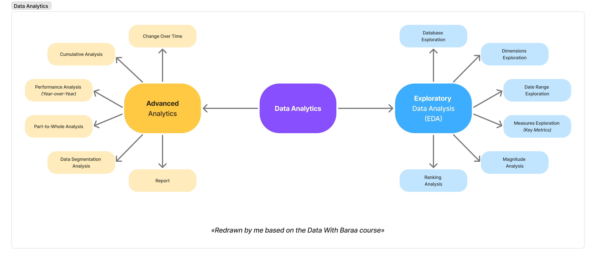

# Exploratory Data Analysis (SQL Server)

[](https://github.com/DataWithBaraa/sql-data-analytics-project)

> **📚 Learning project**
>
> This is a learning project built while following the Exploratory Data Analysis and Advanced Data Analytics projects
> from the free 30-hour *SQL Full Course* by **Baraa Khatib Salkini** ([Data With Baraa](https://github.com/DataWithBaraa/sql-data-warehouse-project)).
>
> - Original repository: https://github.com/DataWithBaraa/sql-data-analytics-project
> - Video tutorial: https://youtu.be/SSKVgrwhzus?si=jnNL6c97yBya66NP
>
> The original idea, structure and data belong to the author. I followed the course
> step by step to practice SQL and exploratory data analysis. 

## Overview

SQL analysis of a sales database (customers, products, sales) in two parts, from a first look at the data to two final reports:



*Diagram redrawn by me in Figma, based on the course.*

- Exploratory Data Analysis (scripts 01–06): database structure, dimensions, date range, key metrics, magnitude and ranking.
- Advanced Analytics (scripts 07–13): change over time, cumulative totals, performance, part-to-whole, segmentation and two reports (customers and products).

## Data

The analysis runs on three tables of a sales data warehouse (Gold layer): `gold.dim_customers`, `gold.dim_products` and `gold.fact_sales`. 
The data is a demo dataset provided by the course author, not real customer data.

## Tech Stack

- SQL Server 2022 or newer
- SQL Server Management Studio (SSMS)
- Git / GitHub
- Figma (diagrams)

## Repository Structure

```
sql-data-analytics-project/
├── datasets/
│   └── csv-files/          # the three Gold tables as CSV files
├── docs/                   # project diagram
├── scripts/                # the SQL scripts
│   ├── 00_init_database.sql
│   ├── 01_database_exploration.sql
│   │   ...
│   └── 13_report_products.sql
├── LICENSE
└── README.md
```

## How to Run

1. Install SQL Server (2022 or newer, required for `DATETRUNC()`) and SSMS.
2. Save the repository on your computer, for example in `C:\sql\sql-data-analytics-project\`.
   If you use another folder, update the three file paths in `scripts/00_init_database.sql`.
3. Run `scripts/00_init_database.sql` (**warning:** it drops and recreates the `DataWarehouseAnalytics` database).
4. Run scripts `01` to `13` in order. Scripts 12 and 13 drop and recreate their views.

## Scripts

| # | Script | What it does |
|---|--------|--------------|
| 00 | `00_init_database.sql` | Creates the `DataWarehouseAnalytics` database and loads the CSV files. |
| 01 | `01_database_exploration.sql` | Explores the structure of the database: tables, views and columns. |
| 02 | `02_dimensions_exploration.sql` | Finds the unique values of the dimensions (countries, categories, products). |
| 03 | `03_date_range_exploration.sql` | Finds the earliest and latest dates to understand the time span of the data. |
| 04 | `04_measures_exploration.sql` | Calculates the key business metrics ("big numbers"). |
| 05 | `05_magnitude_analysis.sql` | Compares measures across categories and dimensions. |
| 06 | `06_ranking_analysis.sql` | Ranks products and customers: Top N and Bottom N. |
| 07 | `07_change_over_time_analysis.sql` | Tracks how measures change over time: trends and seasonality. |
| 08 | `08_cumulative_analysis.sql` | Calculates running totals and averages. |
| 09 | `09_performance_analysis.sql` | Compares current values with the average and with the previous year. |
| 10 | `10_part_to_whole_analysis.sql` | Shows the share of each category in the total. |
| 11 | `11_data_segmentation.sql` | Groups customers and products into segments and aggregates by segment. |
| 12 | `12_report_customers.sql` | Consolidates key customer metrics and behaviors in one view. |
| 13 | `13_report_products.sql` | Consolidates key product metrics and behaviors in one view. |

## Project Series
1. [Data Warehouse project](https://github.com/SleepingMannn/sql-data-warehouse-project/tree/main): ETL, data cleaning and data model.
2. This project: exploratory data analysis and reports in SQL.

## License

This project is licensed under the [MIT License](LICENSE).
The original work is Copyright (c) 2025 Baraa Khatib Salkini.
